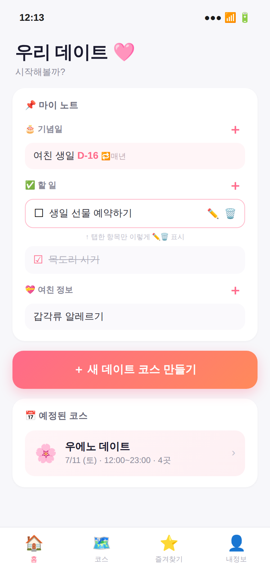

# デートコースビルダー

東京の地元住民が、一日のデートコースを**自分で選んで組み立てる**Webアプリです。

> **AIは判断しない。正確なデータで候補を並べ、ユーザー自身が見て選び、組み立てる。**

## なぜ作るのか

デートの計画は毎回「エリア検索 → スポット検索 → グルメ検索 → 頭の中で組み立て」の繰り返しです。
また、AIにおすすめを聞くと価格や予約情報が間違っていることも多く、結局自分で調べ直すことになります。

このアプリは、バラバラな検索と組み立てを **「エリア → スポット → グルメ → 完成」という一本の流れ（ベルトコンベア）** にまとめます。
候補はGoogle Placesの実データ（評価・価格帯・営業時間）で表示し、判断はユーザー自身が行います。

## 進捗状況

開発計画（Phase 0〜7）に沿って進めています。

| Phase | 内容 | 状況 |
| --- | --- | --- |
| 0 | 企画・設計（製品定義書／データ設計図／画面スケッチ30枚） | 完了 |
| 1 | ホーム画面 | 完了 |
| 2 | 静的画面の作成（ダミーデータ・見た目のみ） | 作業中 |
| 3 | 画面遷移の接続 | ⬜ 予定 |
| 4 | 機能実装（追加・編集・削除、お気に入り、コース保存など） | ⬜ 予定 |
| 5 | 実データ連携（localStorage、Google Places API、地図） | ⬜ 予定 |
| 6〜7 | 仕上げ・実機テスト・発表準備 | ⬜ 予定 |

**完成済みの画面**
- ホーム（Header / TabBar / MyNote / CourseList / DraftCard など）
- 画面1：日付・時間選択（CSS gridによるカレンダー）
- 画面1.5：地域選択（検索ボックス + 地域カードのgrid）
- 画面2：場所選択（再利用コンポーネント `PlaceCard` を作成）
- 画面3：グルメ選択（カテゴリチップ・価格表示）

## 技術スタック

- **言語**：JavaScript / HTML / CSS
- **フレームワーク・ツール**：React 19、Vite
- **開発環境**：Git / GitHub、GitHub Codespaces
- **予定**：Google Places API、localStorage

## 開発の進め方

**「理解していないコードは入れない」** ことをルールにしています。

- 画面ごとに「設計スケッチ確認 → 作成 → スケッチと照合 → コミット」の順で進めています。
- 生成AI（Claude Code）は**学習補助**として使っています。バグの原因の指摘や説明はAIに任せ、コードのタイピングは自分で行います（ルールは `CLAUDE.md` に記載）。
- 学んだことは「自分の疑問 → 説明 → どう理解したか」の形で**学習ログ**に記録しています。

## ドキュメント

| ドキュメント | 内容 |
| --- | --- |
| [製品定義書](<docs/데이트코스빌더_제품정의서_ja.md>) | コンセプト・課題・ターゲット・機能 |
| [データ設計図](<docs/데이트코스빌더_데이터설계도_ja.md>) | データ構造（Place / Course など）の型定義 |
| [開発計画書](<docs/개발계획서_ja.md>) | Phase 0〜7の作業順序と進捗 |
| [学習ログ](<docs/학습로그_ja.md>) | 日ごとの学習と理解のプロセス |
| [画面スケッチ](docs/sketches_final/) | 確定スケッチ30枚 |

※各ドキュメントは韓国語版もあります。

## 設計スケッチ（ホーム）



## ローカルでの起動方法

```bash
npm install
npm run dev
```
